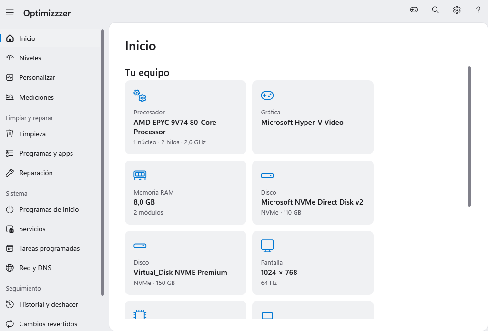
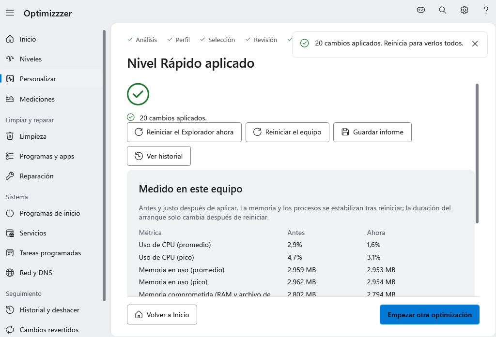
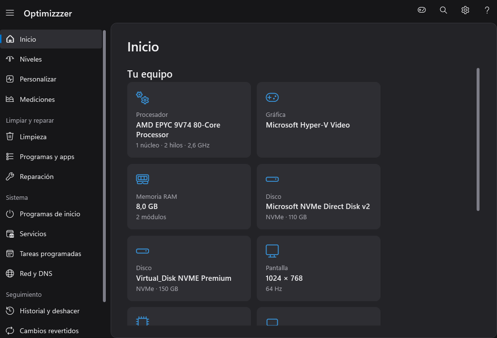

# Optimizzzer

Optimizador para Windows 10 y 11. Es un único `Optimizzzer.exe` de unos 500 KB que no instala nada: funciona con .NET Framework 4.8, que ya viene con Windows 10 (1903 o posterior) y con Windows 11.



| Qué va a pasar, antes de aplicar | Resultado |
|---|---|
|  |  |
|  |  |

Las capturas se generan solas en un Windows de GitHub.

## Qué hace

**Niveles en 1 clic (Inicio)**
1. **Rápido:** lo básico y seguro en menos de un minuto (telemetría, anuncios, apps promocionadas).
2. **Equilibrado:** un escritorio más ágil para el día a día y sin apps preinstaladas inútiles.
3. **Juegos:** Game Mode, sin grabación continua, ratón sin aceleración y menos latencia en juegos en ventana.
4. **Máximo rendimiento:** todo lo que tiene evidencia, aunque quite funciones como el indexador o la hibernación. Pide doble confirmación.

Cada nivel incluye los anteriores. Al elegirlo ves en lenguaje simple qué va a pasar, qué ganas, qué pierdes y si hace falta reiniciar; solo se aplica al confirmar. No se prometen cifras de FPS: la ganancia depende del juego y del equipo, y se mide después.

**También:**
- **Buscador Ctrl+K:** encuentra cualquier página, nivel o ajuste.
- **Avisos claros de éxito y error:** cada error dice qué hacer.
- **Ayuda:** glosario y recorrido de bienvenida.
- **Selecciones portátiles:** exporta e importa archivos `.optz` para repetir la configuración en otro PC.
- **Apariencia:** tema oscuro de serie, con claro o el de Windows a un clic, y 5 colores de acento.
- **Modo ligero automático:** en equipos modestos se quitan las animaciones y las sombras para que vaya fluido.
- **Ventana adaptable:** entra en cualquier pantalla, con el menú reducido a iconos en ventanas estrechas. F11 la pone en pantalla completa.
- **Salud del equipo en Inicio:** espacio libre, días sin reiniciar, último punto de restauración y ajustes revertidos, todo medido.

**Personalizar (paso a paso)**
1. Análisis: lee tu equipo y el estado real de cada ajuste. Solo lee.
2. Perfil: Mínimo seguro, Trabajo y estudio, Juegos, Portátil y batería o Privacidad máxima. Te recomienda uno según tu hardware.
3. Selección: 107 ajustes en 10 categorías, con buscador. Cada uno se puede desplegar para ver por qué, qué pierdes, qué cambia exactamente (clave de registro, servicio o tarea) y la fuente.
4. Revisión: la lista exacta de cambios antes de tocar nada (modo simulación).
5. Aplicar: crea un punto de restauración y guarda el valor anterior de cada cambio. Si un ajuste falla, se revierte solo.
6. Resultado: mediciones antes y después tomadas en tu equipo, e informe HTML.

**Herramientas**
- Limpieza: calcula el espacio a liberar antes de borrar, incluida la caché de Edge, Chrome y Firefox. Cada elemento explica qué es y si es seguro. "Qué ocupa más" muestra las 20 carpetas más grandes (solo mirar). Nunca fuerza archivos en uso.
- Programas y apps: todos los programas, juegos (Steam, Epic, Riot, EA, Ubisoft, Battle.net, GOG, Xbox) y apps de la Store. Desinstala varios a la vez y luego busca los restos: carpetas, claves del registro, accesos directos, tareas y servicios. Los archivos van a la Papelera y las claves se guardan en un `.reg` antes de borrarlas.
- Reparación: DISM, SFC, comprobación de disco, red, Firewall, Windows Update, Microsoft Store y caché de iconos, con la salida visible y guardable. Cada una dice cuándo usarla y qué hace exactamente.
- Red y DNS: dice qué DNS usas por nombre, mide la velocidad real de cada uno, permite volver al anterior y restablecer el adaptador.
- Programas de inicio (con su origen), Servicios (filtros "de otros programas" y "cambiados por mí", y volver al original) y Tareas programadas (desactivar varias a la vez).

**Seguimiento**
- Historial: deshacer cada cambio por separado o una sesión entera.
- Cambios revertidos: detecta qué ajustes ha deshecho una actualización de Windows y los vuelve a aplicar.
- Mediciones: arranque y apagado (del registro de eventos de Windows), CPU, memoria en uso y comprometida, procesos, hilos, servicios, programas de inicio, espacio libre por disco y carpeta temporal. Con gráfico por métrica, exportar a CSV y una medición automática tras el próximo reinicio.

## Qué no hace (a propósito)

No aplica ajustes placebo ni peligrosos. La lista y los motivos están en [docs/EXCLUDED.md](docs/EXCLUDED.md).

Quitar Copilot, Xbox, Edge o la Store, desactivar Defender y pausar Windows Update durante años **no** están en los niveles ni en Personalizar. Viven en una zona aparte, **Bajo tu responsabilidad**, que pide aceptar un aviso antes de mostrarse. Cada acción se puede guardar como script `.ps1` (también en [`scripts/`](scripts)). Lee [docs/RESPONSABILIDAD.md](docs/RESPONSABILIDAD.md): los autores no se hacen cargo de ningún daño.

## Descargar

Descarga `Optimizzzer.exe` desde la sección **Releases** del repositorio (versión actual: v1.3.0). Las notas de cada versión incluyen el hash SHA-256 del ejecutable para comprobar que no se ha modificado.

Windows SmartScreen avisará al abrirlo porque el exe no está firmado. Pulsa "Más información" y luego "Ejecutar de todas formas".

## Línea de comandos

```
Optimizzzer.exe -Scan
Optimizzzer.exe -List
Optimizzzer.exe -Level Gaming -DryRun
Optimizzzer.exe -Level Quick -Silent
Optimizzzer.exe -ApplyFile mi-config.optz -Silent
Optimizzzer.exe -Profile Gaming -DryRun
Optimizzzer.exe -Profile Privacy -Silent -Report informe.html
Optimizzzer.exe -Apply privacy.telemetry,ui.fileExtensions -Silent
Optimizzzer.exe -Undo all
Optimizzzer.exe -Measure antes-de-jugar
```

`-Help` muestra todas las opciones.

## Compilar

- Núcleo y tests en cualquier sistema: `dotnet test tests/Optimizzzer.Tests`
- Ejecutable: `dotnet build src/Optimizzzer.App -c Release`. Funciona en Windows y también en Linux, porque la interfaz se construye en C# sin XAML compilado.

## Antes de usarlo en tu PC

Cada cambio de código se verifica automáticamente en dos Windows reales de GitHub: **Windows 11 Enterprise** (cliente, 10.0.26200) y **Windows Server 2025** (misma base que Windows 11 24H2):

- 63 tests del núcleo, entre ellos "aplicar todo y deshacer deja el estado idéntico".
- Interfaz: primer análisis como en un arranque normal, todas las pantallas en tema claro y oscuro, en español e inglés, y aplicar y deshacer desde el asistente. Se guardan capturas en `docs/screenshots/`.
- Herramientas:
  - Punto de restauración creado y comprobado en la lista de Windows 11.
  - Limpieza.
  - DNS: se cambia a Cloudflare y se vuelve al original.
  - Quitar una app de la Store.
  - Reparación de red y DISM.
  - Programas de inicio, servicios, tareas e informe HTML.
  - Desinstalar un programa de prueba, encontrar sus restos (carpeta, datos y clave) y borrarlos con copia `.reg`.
- Ventana: "Volver a analizar" desde Personalizar, pantalla completa, y la hoja del nivel Máximo a 1280x720, 1024x640 y 800x600 con el botón Aplicar siempre visible.
- Ida y vuelta por línea de comandos: aplica 18 ajustes de registro, servicios, tareas programadas, DirectX y plan de energía. Después comprueba que quedan aplicados, lo deshace todo y verifica que el análisis final es idéntico al inicial.

GitHub ya no ofrece máquinas con Windows 10, así que Windows 10 no se prueba automáticamente. Si lo usas en Windows 10, haz antes una pasada en una máquina virtual:

1. Abre la app y completa el análisis.
2. Aplica el nivel Rápido desde Inicio.
3. Comprueba en Historial que aparecen los cambios.
4. Pulsa "Deshacer toda la sesión" y verifica que el estado vuelve a ser el de antes con un nuevo análisis.
5. Prueba Limpieza, Red y DNS (y "Volver a mi DNS anterior").
6. Cambia el tema y el idioma, y navega con el teclado (Tab, Enter, Esc).

Si ejecutas la app con una cuenta de administrador distinta a la tuya, los ajustes de usuario (HKCU) se aplican a esa cuenta, no a la tuya.

## Datos que guarda

Todo queda en `C:\ProgramData\Optimizzzer`: el diario para deshacer, las mediciones (se borran solas a los 7 días, salvo las exportadas), la copia de seguridad del DNS y los ajustes de idioma y tema. La única otra huella es la tarea "Medir después de reiniciar", y solo si la programas. No escribe en `%TEMP%` ni instala nada.

En Ajustes > Datos y rastros ves qué hay y por qué. Puedes pedir que se borre todo al cerrar si no queda nada por deshacer, o borrarlo todo de una vez. Borrar la carpeta no deshace cambios, solo olvida el historial.

## Licencia

MIT, ver [LICENSE](LICENSE).

## Créditos

Los ajustes se han reimplementado a partir de la documentación de Microsoft y del trabajo de estos proyectos, sin copiar su código:
[hellzerg/optimizer](https://github.com/hellzerg/optimizer),
[ChrisTitusTech/winutil](https://github.com/ChrisTitusTech/winutil),
[itsfatduck/optimizerDuck](https://github.com/itsfatduck/optimizerDuck),
[churupitaromario-ops/system-tweaks-wintoys](https://github.com/churupitaromario-ops/system-tweaks-wintoys) y
[nokaraempire/nokara-system-manager](https://github.com/nokaraempire/nokara-system-manager).

Las reglas de diseño vienen de [antislop](https://github.com/miqdadbadjuber/anti-slop) (MIT), instalado en `.claude/skills/`. La dirección visual está en [DESIGN.md](DESIGN.md).
