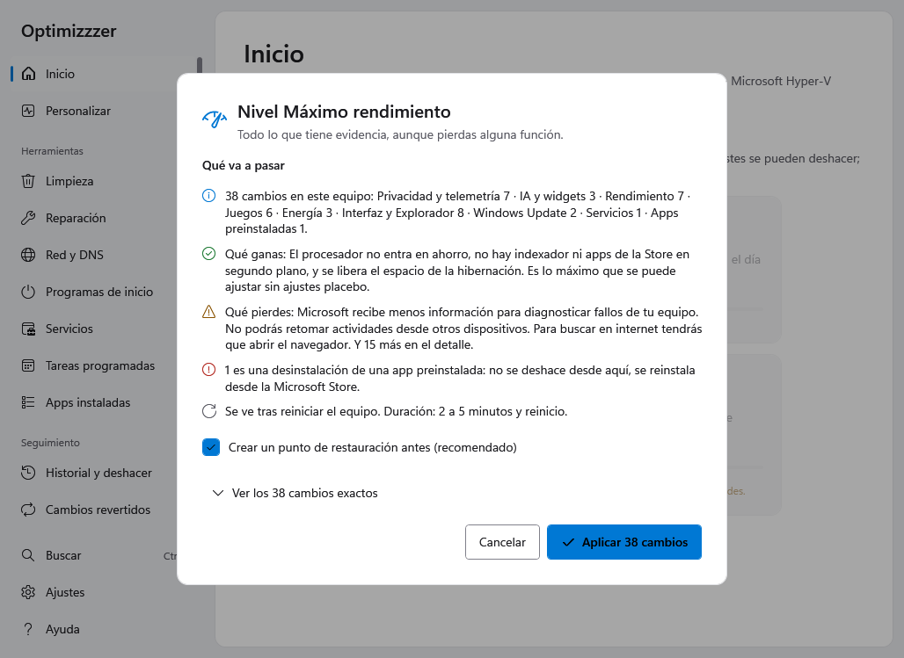
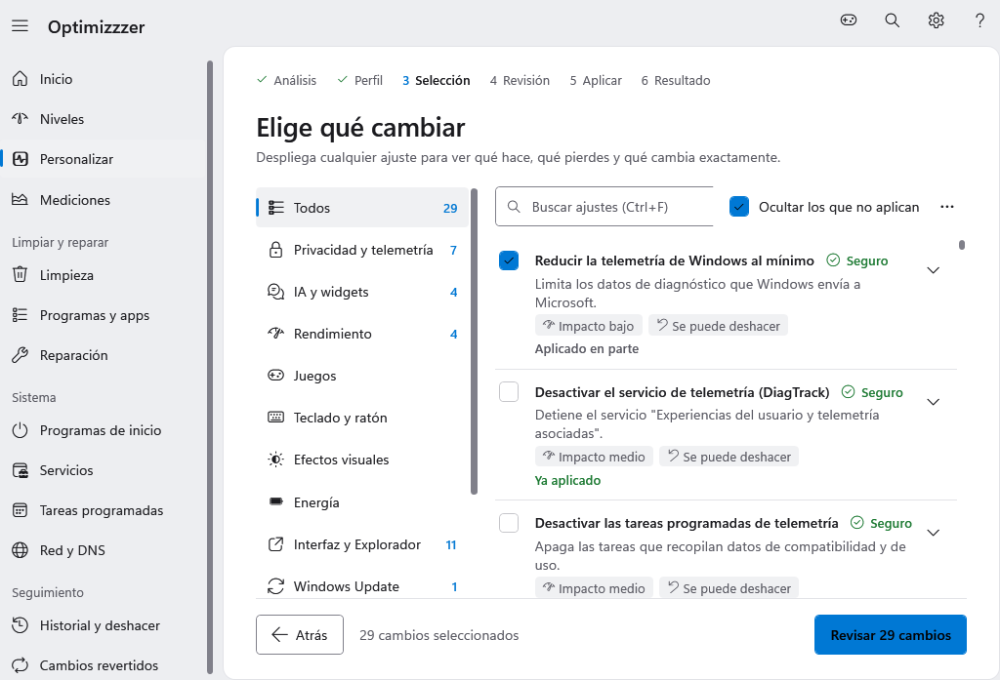
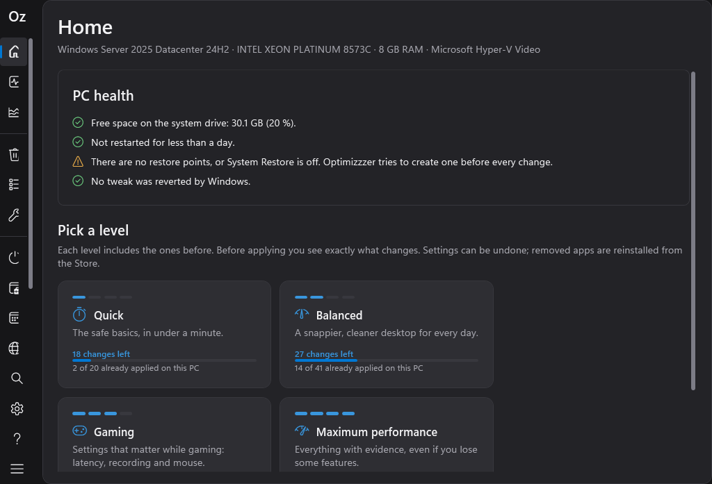

# Optimizzzer

Optimizador para Windows 10 y 11. Es un único `Optimizzzer.exe` de unos 500 KB que no instala nada: funciona con .NET Framework 4.8, que ya viene con Windows 10 (1903 o posterior) y con Windows 11.


| Qué va a pasar, antes de aplicar | Resultado |
|---|---|
|  |  |
|  |  |

Las capturas se generan solas en un Windows de GitHub.

## Qué hace

**Niveles en 1 clic (Inicio)**
1. **Rápido:** lo básico y seguro en menos de un minuto (telemetría, anuncios, apps promocionadas).
2. **Equilibrado:** un escritorio más ágil para el día a día y sin apps preinstaladas inútiles.
3. **Juegos:** Game Mode, sin grabación continua, ratón sin aceleración y menos latencia en juegos en ventana.
4. **Máximo rendimiento:** todo lo que tiene evidencia, aunque quite funciones como el indexador o la hibernación. Pide doble confirmación.

Cada nivel incluye los anteriores. Al elegirlo ves en lenguaje simple qué va a pasar, qué ganas, qué pierdes y si hace falta reiniciar; solo se aplica al confirmar. No se prometen cifras de FPS: la ganancia depende del juego y del equipo, y se mide después.

**También:**
- **Buscador Ctrl+K:** encuentra cualquier página, nivel o ajuste.
- **Avisos claros de éxito y error:** cada error dice qué hacer.
- **Ayuda:** glosario y recorrido de bienvenida.
- **Selecciones portátiles:** exporta e importa archivos `.optz` para repetir la configuración en otro PC.
- **Apariencia:** tema claro/oscuro con 5 colores de acento.
- **Modo ligero automático:** en equipos modestos se quitan las animaciones y las sombras para que vaya fluido.

**Personalizar (paso a paso)**
1. Análisis: lee tu equipo y el estado real de cada ajuste. Solo lee.
2. Perfil: Mínimo seguro, Trabajo y estudio, Juegos, Portátil y batería o Privacidad máxima. Te recomienda uno según tu hardware.
3. Selección: 107 ajustes en 10 categorías, con buscador. Cada uno se puede desplegar para ver por qué, qué pierdes, qué cambia exactamente (clave de registro, servicio o tarea) y la fuente.
4. Revisión: la lista exacta de cambios antes de tocar nada (modo simulación).
5. Aplicar: crea un punto de restauración y guarda el valor anterior de cada cambio. Si un ajuste falla, se revierte solo.
6. Resultado: mediciones antes y después tomadas en tu equipo, e informe HTML.

**Herramientas**
- Limpieza: calcula el espacio a liberar antes de borrar. Nunca fuerza archivos en uso.
- Reparación: DISM, SFC, red, Windows Update, Microsoft Store y caché de iconos, con la salida visible.
- Red y DNS: mide la velocidad real de cada DNS desde tu conexión y permite volver al anterior.
- Programas de inicio, Servicios, Tareas programadas y Apps instaladas.

**Seguimiento**
- Historial: deshacer cada cambio por separado o una sesión entera.
- Cambios revertidos: detecta qué ajustes ha deshecho una actualización de Windows y los vuelve a aplicar.
- Mediciones: memoria en uso, procesos, servicios, programas de inicio, espacio libre y duración del arranque (del registro de eventos de Windows).

## Qué no hace (a propósito)

No aplica ajustes placebo ni peligrosos. La lista y los motivos están en [docs/EXCLUDED.md](docs/EXCLUDED.md). Tampoco desactiva Windows Defender ni Windows Update, ni desinstala Edge.

## Descargar

Descarga `Optimizzzer.exe` desde la sección **Releases** del repositorio (versión actual: v1.1.1). Las notas de cada versión incluyen el hash SHA-256 del ejecutable para comprobar que no se ha modificado.

Windows SmartScreen avisará al abrirlo porque el exe no está firmado. Pulsa "Más información" y luego "Ejecutar de todas formas".

## Línea de comandos

```
Optimizzzer.exe -Scan
Optimizzzer.exe -List
Optimizzzer.exe -Level Gaming -DryRun
Optimizzzer.exe -Level Quick -Silent
Optimizzzer.exe -ApplyFile mi-config.optz -Silent
Optimizzzer.exe -Profile Gaming -DryRun
Optimizzzer.exe -Profile Privacy -Silent -Report informe.html
Optimizzzer.exe -Apply privacy.telemetry,ui.fileExtensions -Silent
Optimizzzer.exe -Undo all
```

`-Help` muestra todas las opciones.

## Compilar

- Núcleo y tests en cualquier sistema: `dotnet test tests/Optimizzzer.Tests`
- Ejecutable: `dotnet build src/Optimizzzer.App -c Release`. Funciona en Windows y también en Linux, porque la interfaz se construye en C# sin XAML compilado.

## Antes de usarlo en tu PC

Cada cambio de código se verifica automáticamente en dos Windows reales de GitHub: **Windows 11 Enterprise** (cliente, 10.0.26200) y **Windows Server 2025** (misma base que Windows 11 24H2):

- 52 tests del núcleo, entre ellos "aplicar todo y deshacer deja el estado idéntico".
- Interfaz: primer análisis como en un arranque normal, todas las pantallas en tema claro y oscuro, en español e inglés, y aplicar y deshacer desde el asistente. Se guardan capturas en `docs/screenshots/`.
- Herramientas:
  - Punto de restauración creado y comprobado en la lista de Windows 11.
  - Limpieza.
  - DNS: se cambia a Cloudflare y se vuelve al original.
  - Quitar una app de la Store.
  - Reparación de red y DISM.
  - Programas de inicio, servicios, tareas e informe HTML.
- Ida y vuelta por línea de comandos: aplica 18 ajustes de registro, servicios, tareas programadas, DirectX y plan de energía. Después comprueba que quedan aplicados, lo deshace todo y verifica que el análisis final es idéntico al inicial.

GitHub ya no ofrece máquinas con Windows 10, así que Windows 10 no se prueba automáticamente. Si lo usas en Windows 10, haz antes una pasada en una máquina virtual:

1. Abre la app y completa el análisis.
2. Aplica el nivel Rápido desde Inicio.
3. Comprueba en Historial que aparecen los cambios.
4. Pulsa "Deshacer toda la sesión" y verifica que el estado vuelve a ser el de antes con un nuevo análisis.
5. Prueba Limpieza, Red y DNS (y "Volver a mi DNS anterior").
6. Cambia el tema y el idioma, y navega con el teclado (Tab, Enter, Esc).

Si ejecutas la app con una cuenta de administrador distinta a la tuya, los ajustes de usuario (HKCU) se aplican a esa cuenta, no a la tuya.

## Datos que guarda

Todo queda en `C:\ProgramData\Optimizzzer`: el diario para deshacer, las mediciones, la copia de seguridad del DNS y los ajustes de idioma y tema. Borrar la carpeta no deshace nada, solo olvida el historial.

## Licencia

MIT, ver [LICENSE](LICENSE).

## Créditos

Los ajustes se han reimplementado a partir de la documentación de Microsoft y del trabajo de estos proyectos, sin copiar su código:
[hellzerg/optimizer](https://github.com/hellzerg/optimizer),
[ChrisTitusTech/winutil](https://github.com/ChrisTitusTech/winutil),
[itsfatduck/optimizerDuck](https://github.com/itsfatduck/optimizerDuck),
[churupitaromario-ops/system-tweaks-wintoys](https://github.com/churupitaromario-ops/system-tweaks-wintoys) y
[nokaraempire/nokara-system-manager](https://github.com/nokaraempire/nokara-system-manager).

Las reglas de diseño vienen de [antislop](https://github.com/miqdadbadjuber/anti-slop) (MIT), instalado en `.claude/skills/`. La dirección visual está en [DESIGN.md](DESIGN.md).
